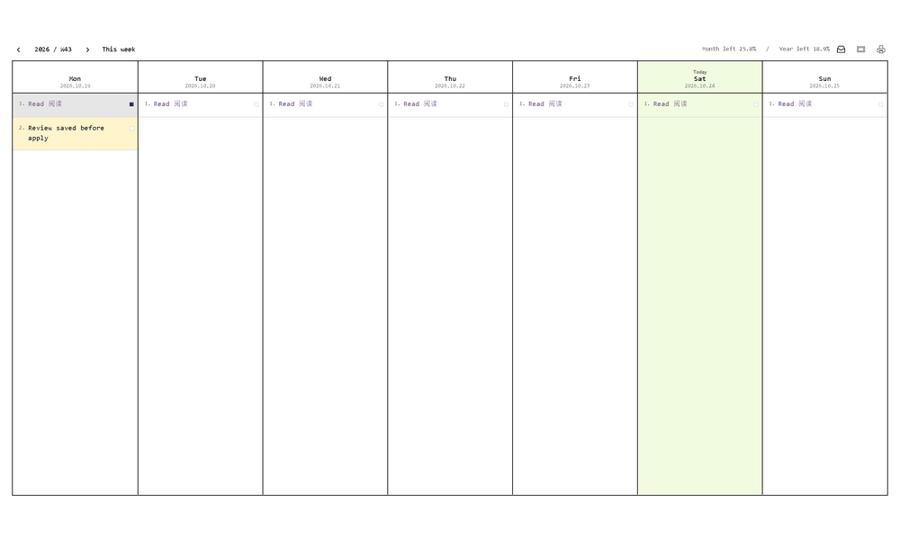

# TaskBoard

  
  
<strong>A quiet weekly board for seeing time, tasks, and priorities together.</strong>

  
一个安静、清晰的周任务看板，让时间、任务和重点一目了然。

  
<a href="https://github.com/ArdeaNew/TaskBoard/releases/latest">Download / 下载</a> · <a href="#highlights--亮点">Highlights / 亮点</a> · <a href="LICENSE">MIT</a>

## Highlights / 亮点

### Time in view / 时间始终可见

- ISO week number, month remaining, and year remaining stay in the header.
- Each weekday shows its calendar date.
- A quiet green `Today` marker identifies the current day.

- 顶部始终显示 ISO 周数、当月剩余百分比和全年剩余百分比。
- Mon–Sun 下方显示对应日期。
- 淡绿色 `Today` 提示标记当天，保持视觉克制。

### Tasks that stay in order / 任务保持秩序

- Click empty space to add at the end of a day.
- Click a task to edit it in place.
- Drag to reorder or move a task to another day.
- A blue square marks completion; completed blocks turn medium-light gray and move to the top.
- Choose text and background colors for individual tasks.

- 点击空白处，在当天任务末尾新增。
- 点击任务即可编辑。
- 拖动任务排序，或移动到另一天。
- 蓝色小方块表示完成；完成任务变为中浅灰色并置顶。
- 每项任务都可以单独设置文字色和背景色。

### Daily planning and inbox / 日常计划与收集箱

- Apply a task to every day, or move it to the next week's Sunday.
- Browse previous and future weeks without losing saved plans.
- Collect ideas in **Work 1 / Work 2 / Life**, then schedule them onto the displayed week.

- 将任务应用到每天，或移动到下周周日。
- 查看过去或未来的周，不会丢失已经保存的计划。
- 在 **Work 1 / Work 2 / Life** 收集箱中暂存想法，再安排到正在查看的周。

### A clear finish / 清晰的输出

- Preview and print the complete week on A4 landscape paper.
- Export the complete week as a high-resolution PNG.
- English interface, monospace Latin text, and SimSun Chinese text.
- Fully local: no account and no network connection are required.

- 支持 A4 横向整页预览和打印。
- 导出包含完整七天任务的高清 PNG 图片。
- 英文界面，英文使用等宽字体，中文使用宋体。
- 完全本地运行，无需账号和网络连接。

## Quick start / 快速开始

1. Use Windows 10/11 with .NET Framework 4.8 or later.
2. Download `TaskBoard-<version>-portable.zip` from [Releases](https://github.com/ArdeaNew/TaskBoard/releases/latest).
3. Extract all files and open `TaskBoard.exe`.
4. Keep `TaskBoard.exe.config` beside the executable.

1. 在 Windows 10/11 上安装 .NET Framework 4.8 或更高版本。
2. 从 [Releases](https://github.com/ArdeaNew/TaskBoard/releases/latest) 下载 `TaskBoard-<version>-portable.zip`。
3. 完整解压后打开 `TaskBoard.exe`。
4. 保留程序旁的 `TaskBoard.exe.config`。

The window opens at about 70% of the available work area. Use the arrows to browse weeks, choose a date from the week number, or select **This week**.

窗口默认占可用屏幕约 70%。使用箭头切换周，点击周数选择日期，或点击 **This week** 返回本周。

## Everyday actions / 常用操作

| Action | How to use |
| --- | --- |
| Add / 新增 | Click blank space. The new task is appended to the day. |
| Edit / 编辑 | Click a task, type, then press Enter. Use Shift+Enter for a new line. |
| Complete / 完成 | Click the small square at the end of a task. |
| Colors / 颜色 | Use the dot for text color; right-click for a full-block background. |
| Daily task / 日常任务 | Right-click **Apply to every day**. |
| Inbox / 收集箱 | Open the header inbox icon, then right-click **Schedule for**. |
| Print / 打印 | Use the print icon for A4 preview, then choose **Print**. |
| Export / 导出 | Use the image icon or press `Ctrl+Shift+S`. |

## Local data / 本地数据

TaskBoard saves tasks, inbox groups, and week history in `%LOCALAPPDATA%\\TaskBoard`. Copy that folder while the app is closed to make a backup or move your data to another computer.

TaskBoard 将任务、收集箱和周历史保存在 `%LOCALAPPDATA%\\TaskBoard`。关闭程序后复制整个目录，即可备份或迁移数据。

## License / 许可证

[MIT License](LICENSE)
