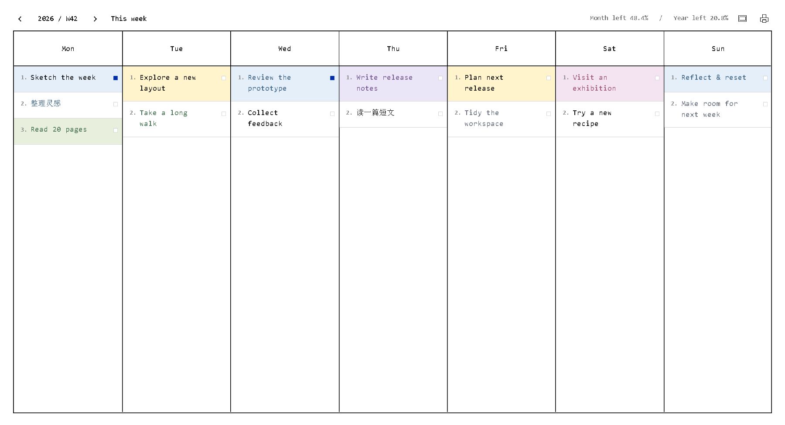
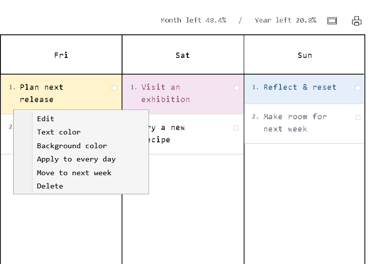

# TaskBoard

极简 Windows 周任务看板。**ISO 周数、当月剩余百分比、全年剩余百分比**始终可见，让一周的计划与时间进度放在一起。

A minimal weekly task board for Windows. **The ISO week number, month remaining, and year remaining** keep your plans and the passage of time in view.

[下载最新版 / Download](https://github.com/ArdeaNew/TaskBoard/releases/latest) · [快速开始 / Get started](#快速开始--get-started) · [开发文档 / Architecture](docs/ARCHITECTURE.md)

- 七天并列，整块任务、独立文字色与背景色，支持顺滑拖拽、每日重复任务、A4 打印预览与 PNG 导出。
  Seven day columns with full-width task blocks, individual text/background colors, smooth dragging, daily tasks, A4 print preview, and PNG export.
- 未完成任务在跨周时自动集中到新周周日；右击也可将单项任务移至下周周日。
  Unfinished tasks gather on the new week's Sunday at rollover; a context-menu action also moves any task to the following week's Sunday.
- 完全本地运行，无需账号；原生 WPF / .NET Framework 4.8，零第三方运行依赖。界面为英文，英文等宽 Consolas、中文宋体。
  Fully local, with no account required. Native WPF / .NET Framework 4.8 with no third-party runtime dependencies. English interface; Consolas for Latin text and SimSun for Chinese text.

## 界面预览 / Preview



**周数与时间进度始终可见。** 示例日期为 2026-10-17，显示 ISO 第 42 周、月余 48.4% 与年余 20.8%；任务、颜色及日期均为专门构造的演示数据，不含本机使用数据。

**Keep the week and time remaining in view.** The sample date, 2026-10-17, shows ISO week 42, 48.4% of the month and 20.8% of the year remaining. All tasks, colors, and dates are fictional demonstration fixtures, with no local usage data.



右击任务，选择 **Move to next week**，将它移动到所选周的下一周周日。图片由真实 WPF 控件在隔离目录中离屏绘制，未截取桌面或读取个人看板；[复现图片](#从源码构建--build-from-source)。

Right-click a task and choose **Move to next week** to move it to the Sunday after the selected week. Images are rendered off-screen from the real WPF controls in an isolated directory, without capturing the desktop or reading a personal board. [Reproduce the images](#从源码构建--build-from-source).

## 快速开始 / Get started

1. Windows 10/11 需具备 .NET Framework 4.8 或更高版本。下载 `TaskBoard-<version>-portable.zip` 并完整解压。
   On Windows 10/11 with .NET Framework 4.8 or later, download and extract `TaskBoard-<version>-portable.zip`.
2. 双击 `TaskBoard.exe`，保留同目录的 `TaskBoard.exe.config`。无需安装或开发工具。
   Open `TaskBoard.exe` and keep `TaskBoard.exe.config` beside it. No installation or development tools are needed.

默认打开本周，窗口居中，占可用屏幕宽高的约 70%。任务自动保存在本机，不联网、不上传。

The app opens the current week in a centered window using about 70% of the work area. Tasks save automatically on your computer; the app makes no network requests or uploads.

## 周数与剩余时间 / Week and time remaining

顶部周数遵循 ISO 8601，每周从周一开始。左右箭头切换周，点击周数选择日期，**This week** 返回本周；可查看历史周，也可提前计划未来周。

The header uses ISO 8601 week numbers, with weeks starting on Monday. Use the arrows to browse weeks, click the week number to choose a date, or select **This week** to return. Review past weeks or plan ahead.

月余与年余按系统当天计算，**剩余天数包含今天**：月余为“本月剩余天数 ÷ 本月总天数”，年余同理。浏览其他周时，这两个百分比仍反映今天；周数则对应正在查看的周。

Month and year remaining use the system date and **include today**: remaining days divided by the total days in that month or year. These percentages continue to reflect today when you browse another week; the week number follows the selected week.

各周的任务、顺序与完成状态独立保存。首次打开本周或未来周时，会从最近较早的已知周带入日常任务并重置完成状态。已有计划保持原样，尚无计划的过去周为空白。

Each week saves its tasks, order, and completion separately. A new current or future week inherits daily tasks from the nearest earlier known week, with completion reset. Existing plans stay intact; unplanned past weeks are empty.

**跨周自动延续：** 系统进入新周时，或关闭一段时间后重新打开应用，所有已保存的过去周中未完成任务会移动到系统本周周日的末尾。已完成任务保留在原周，未来计划不受影响。未完成的日常任务视为独立待办移动，不与新周的日常副本关联；正常日常任务仍先按规则继承。即使错过多个星期，也只移动实际存在的任务，不补造未打开周的日常副本。单纯浏览未来周不会提前触发延续。

**Automatic rollover:** When the system enters a new week, or when you reopen the app after time away, unfinished tasks from saved past weeks move to the end of the actual current week's Sunday. Completed tasks stay in their original weeks and future plans stay intact. Missed daily occurrences become independent pending tasks; normal daily inheritance runs first. After several missed weeks, only existing tasks move—no daily copies are invented for weeks never opened. Browsing a future week alone does not trigger an early rollover.

## 任务操作 / Tasks

- **新增与编辑**：点击某一天的空白处，新任务始终添加在该天所有现有任务的末尾。点击任务编辑；Enter 保存，Shift+Enter 换行，Esc 取消。中文输入法选词时不会提前保存。
  **Add and edit:** Click blank space in a day to append a task after all its existing tasks. Click a task to edit; Enter saves, Shift+Enter inserts a line break, and Esc cancels. Confirming an IME composition does not submit the edit early.
- **颜色**：任务上的圆点设置文字色；右击选择 **Background color** 填充整个区块。支持预设与 `#RRGGBB` 自定义色值，选择 **No fill** 可清除背景。
  **Colors:** Use the task's dot for text color, or right-click → **Background color** to fill the entire block. Choose a preset or `#RRGGBB` value, or **No fill** to clear the background.
- **排序与完成**：拖动调整顺序，普通任务可跨天移动；编辑时使用左侧拖动柄。点击末尾方块切换完成状态，蓝色方块表示完成，完成项排在上方。未完成任务按用户顺序排列，日常任务不会自动被推到末尾，序号随顺序更新。
  **Order and completion:** Drag to reorder; ordinary tasks can move between days. Use the left handle while editing. The trailing square toggles completion: a blue square marks a completed task, which moves to the top. Pending tasks keep your chosen order; daily tasks are not continually moved to the bottom. Numbering updates with the order.
- **日常任务**：右击 → **Apply to every day**，在所选周每天创建副本，并将未完成副本放到当天末尾；重复操作不重复生成，已有完成副本仍在上方。组内文字与文字色同步，各天背景色与完成状态独立。日常任务可在当天排序，不能跨天拖动。
  **Daily tasks:** Right-click → **Apply to every day** to create copies throughout the selected week and place pending copies at each day's end. Repeating it does not duplicate tasks; completed copies stay at the top. Text and text color stay linked; backgrounds and completion are independent. Daily tasks can be reordered within their day but cannot be dragged to another day.
- **移至下周**：右击 → **Move to next week**，将这一项移动到所选周的下一周周日。文字、颜色、完成状态保留；日常任务仅移动当前这一项并解除关联，不影响其他副本。Ctrl+Z 同时恢复来源周和目标周；切周后撤销历史重置。
  **Move to next week:** Right-click → **Move to next week** to move just that task to the following week's Sunday. Text, colors, and completion remain intact. Moving a daily occurrence detaches only that occurrence, leaving its peers unchanged. Ctrl+Z restores both source and destination weeks; navigating resets undo history.
- **删除与清空**：右击任务可删除。鼠标停留在某一天底部后显示 **Clear day**；核对确认框中的日期及任务数，确认后仅清空该天。Ctrl+Z 可撤销。
  **Delete and clear:** Delete a task from its context menu. Hover at the bottom of a day to reveal **Clear day**. Check the date and count in the confirmation; only that day is cleared. Ctrl+Z undoes the operation.
- **打印与导出**：顶部打印图标打开整页预览，可缩放、选择 **Fit page**，再点击 **Print**。默认 A4 横向、约 8 mm 页边距，文字与线条以矢量输出。PNG 同样包含完整七天、屏幕滚动范围外的任务、序号、颜色和完成标记。
  **Print and export:** The print icon opens a full-page preview with zoom, **Fit page**, and **Print**. The default is A4 landscape with about 8 mm margins and vector text/lines. PNG export also includes all seven days, tasks beyond the visible scroll area, numbering, colors, and completion marks.

程序提供的界面文字为英文；Windows 原生打印及保存对话框跟随系统语言。用户输入的中文任务内容照常保留。

App-owned interface text is English; native Windows print and save dialogs follow the system language. Chinese task content remains unchanged.

## 快捷键 / Keyboard shortcuts

| 按键 / Keys | 中文 | English |
| --- | --- | --- |
| Ctrl+N | 在所选周中今天对应的星期列末尾新增 | Append to today's weekday in the selected week |
| F2 / Enter | 编辑选中的任务 | Edit the selected task |
| Enter | 保存编辑 | Save the edit |
| Shift+Enter | 编辑时换行 | Insert a line break |
| Esc | 取消编辑或拖动 | Cancel editing or dragging |
| Delete | 删除选中的任务 | Delete the selected task |
| Ctrl+Z | 撤销；切换周后重新开始记录 | Undo; the history resets when switching weeks |
| Ctrl+P | 打印预览；预览中按下则打印 | Open print preview; print when already in preview |
| Ctrl+Shift+S | 导出所选周为 PNG | Export the selected week as PNG |

## 数据与备份 / Data and backup

默认目录 `%LOCALAPPDATA%\TaskBoard` 中，`board.json` 保存所有周，`board.backup.json` 保存上一次成功写入的数据。备份或迁移前关闭程序，再复制整个目录。数据损坏时，程序保留原件并尝试恢复备份。

In `%LOCALAPPDATA%\TaskBoard`, `board.json` stores all weeks and `board.backup.json` holds the previous successful save. Close the app before copying the whole directory for backup or migration. If data is damaged, the app preserves the original and attempts backup recovery.

需要独立目录时使用以下参数；开发测试时也应使用隔离目录。

Use a separate directory with this option; use an isolated directory for development tests too.

```powershell
.\TaskBoard.exe --data-dir "D:\TaskBoardData"
```

## 从源码构建 / Build from source

预先安装 .NET SDK 10 和 .NET Framework 4.8 Developer Pack。项目不使用第三方包，构建不执行联网还原。

Install .NET SDK 10 and the .NET Framework 4.8 Developer Pack first. The project uses no third-party packages and performs no online package restore.

```powershell
powershell -NoProfile -ExecutionPolicy Bypass -File .\build.ps1 -Test
.\artifacts\app\TaskBoard.exe --data-dir ".\qa-data"
powershell -NoProfile -ExecutionPolicy Bypass -File .\package.ps1
```

重新生成说明图片时，执行以下命令。工具只使用源代码内的虚构样例，临时数据放在 `artifacts/demo` 并在结束后清理；图片输出到 `docs/images`。它不读取默认数据目录，也不截取屏幕。

To regenerate documentation images, run the command below. The tool uses only fictional fixtures embedded in its source, keeps temporary data under `artifacts/demo`, and cleans it afterward. Images go to `docs/images`. It never reads the default data directory or captures the screen.

```powershell
powershell -NoProfile -ExecutionPolicy Bypass -File .\tools\Create-DemoImages.ps1
```

程序输出到 `artifacts\app`，测试与预览输出到 `artifacts\tests`；`dist` 包含便携包、源码包和 SHA-256 校验文件。详见[架构](docs/ARCHITECTURE.md)、[贡献指南](CONTRIBUTING.md)、[发布检查](docs/RELEASE_CHECKLIST.md)和[验证记录](VALIDATION.md)。

The app builds into `artifacts\app`, tests/previews into `artifacts\tests`, and portable/source archives with SHA-256 checksums into `dist`. See [architecture](docs/ARCHITECTURE.md), [contributing](CONTRIBUTING.md), [release checks](docs/RELEASE_CHECKLIST.md), and [validation](VALIDATION.md).

## 许可证 / License

采用 [MIT 许可证](LICENSE)。 / Licensed under [MIT](LICENSE).
