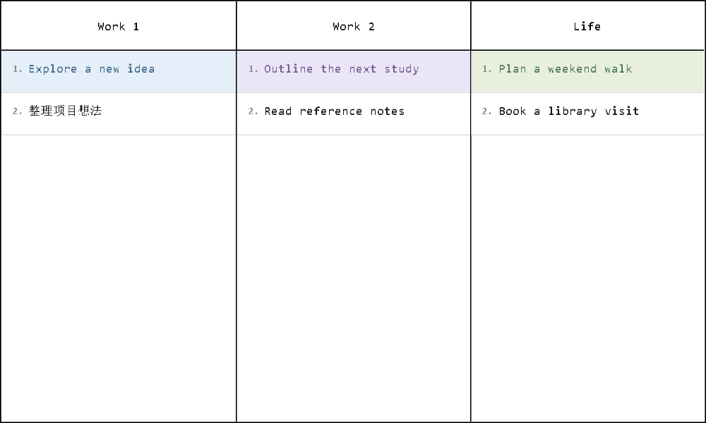

# TaskBoard

极简 Windows 周任务看板。**ISO 周数、当月剩余百分比、全年剩余百分比**始终可见，让计划与时间进度放在一起。

A minimal weekly task board for Windows. **The ISO week number, month remaining, and year remaining** keep your plans and the passage of time in view.

[下载最新版 / Download](https://github.com/ArdeaNew/TaskBoard/releases/latest) · [快速开始 / Get started](#快速开始--get-started) · [MIT](LICENSE)


## 功能 / Features

- **周计划与时间进度**：七天并列，查看历史周、计划未来周；周数跟随查看的周，月余和年余始终按系统当天计算，剩余天数包含今天。
  **Weekly planning and time progress:** Seven day columns for past, current, and future plans. The week number follows the displayed week; month/year remaining use today's date and include today.
- **自由整理任务**：点击空白处在末尾新增，点击编辑，拖动排序或跨天移动；每项任务可单独设置文字色和背景色。蓝色小方块表示完成，完成项置顶。
  **Flexible tasks:** Click blank space to append, click a task to edit, and drag to reorder or move between days. Set individual text and background colors. A blue square marks completion, and completed tasks move to the top.
- **日常任务与跨周延续**：将任务应用到每天；过去周中未完成的任务自动移到系统本周周日，也可手动移至下周周日。
  **Daily tasks and rollover:** Apply a task to every day. Unfinished tasks from past weeks automatically move to the current week's Sunday, or move a task manually to the following week's Sunday.
- **任务收集箱**：通过顶部图标打开 **Work 1 / Work 2 / Life**，暂存待安排的任务，并与周看板双向移动。
  **Inbox:** Open **Work 1 / Work 2 / Life** from the header icon to collect tasks and move them to or from the weekly board.
- **打印与导出**：A4 横向整页打印预览、缩放和 PNG 导出，包含完整七天的任务。
  **Print and export:** A4 landscape print preview, zoom, and PNG export include the full week's tasks.
- **完全本地运行**：无需账号，自动保存到本机。英文界面，英文使用等宽字体，中文使用宋体。
  **Fully local:** No account required; tasks save automatically on your computer. English interface, monospace Latin text, and SimSun for Chinese text.

## 快速开始 / Get started

1. 在 Windows 10/11 上安装 .NET Framework 4.8 或更高版本。
   Use Windows 10/11 with .NET Framework 4.8 or later.
2. [下载](https://github.com/ArdeaNew/TaskBoard/releases/latest) `TaskBoard-<version>-portable.zip`，完整解压后双击 `TaskBoard.exe`。
   [Download](https://github.com/ArdeaNew/TaskBoard/releases/latest) `TaskBoard-<version>-portable.zip`, extract all files, and open `TaskBoard.exe`.
3. 保留程序旁的 `TaskBoard.exe.config`，无需安装程序。
   Keep `TaskBoard.exe.config` beside the executable. No installer is needed.

默认打开本周，窗口居中，占可用屏幕宽高的约 70%。顶部箭头切换周，点击周数选择日期，**This week** 返回本周。

The app opens the current week in a centered window using about 70% of the work area. Use the header arrows to browse weeks, click the week number to choose a date, or select **This week** to return.

## 任务操作 / Task actions


| 操作 / Action | 使用方式 / How to use |
| --- | --- |
| 新增与编辑 / Add and edit | 点击空白处新增，点击任务编辑。Enter 保存，Shift+Enter 换行，Esc 取消。 / Click blank space to append or a task to edit. Enter saves, Shift+Enter adds a line, and Esc cancels. |
| 颜色 / Colors | 圆点设置文字色；右击 **Background color** 设置整块背景，**No fill** 清除背景。 / Use the dot for text color; right-click **Background color** for a full-block fill, or **No fill** to clear it. |
| 排序与完成 / Order and completion | 拖动调整顺序，普通任务可跨天移动；点击末尾方块切换完成。 / Drag to reorder or move ordinary tasks between days; click the trailing square to toggle completion. |
| 日常任务 / Daily tasks | 右击 **Apply to every day**，在该周每天创建副本；文字和文字色同步，完成状态与背景色独立。 / Right-click **Apply to every day** to create copies throughout the week. Text and text color stay linked; completion and backgrounds are independent. |
| 移至下周 / Move to next week | 右击 **Move to next week**，移到正在查看周的下一周周日。 / Right-click **Move to next week** to move the task to the Sunday after the displayed week. |
| 删除与清空 / Delete and clear | 右击删除单项；鼠标停留在某天底部显示 **Clear day**，确认后清空该天。 / Delete a task from its context menu, or hover at a day's bottom for **Clear day** and confirm. |

日常任务可在当天排序。将其中一项移到下周或收集箱时，只解除该项与其他副本的关联。跨周自动延续保留已完成的历史任务和未来计划；浏览未来周不会提前触发延续。

Daily tasks can be reordered within their day. Moving one occurrence to the next week or inbox detaches only that occurrence. Automatic rollover keeps completed history and future plans intact; browsing future weeks does not trigger it early.

## 任务收集箱 / Inbox



点击顶部收集箱图标打开 **Work 1 / Work 2 / Life**。点击组内空白处新增、点击任务编辑，字体和任务区块与主界面一致。

Open **Work 1 / Work 2 / Life** with the header inbox icon. Click blank space in a group to add or a task to edit, with the same typography and task blocks as the board.

- 收集箱右击 **Schedule for**，选择日期，移动到主看板**正在查看的周**。
  In the inbox, right-click **Schedule for** and choose a date in the week **currently displayed on the board**.
- 主看板右击 **Move to inbox**，选择分组；收集箱右击 **Move to group** 可调整分组。
  On the board, right-click **Move to inbox** and choose a group. In the inbox, use **Move to group** to regroup tasks.
- 移动保留任务文字、颜色和完成状态。收集箱独立于周计划，不包含在周打印和导出图片中。
  Moves preserve text, colors, and completion. The inbox is independent of week navigation and is excluded from weekly printouts and image exports.

## 打印与快捷键 / Printing and shortcuts

顶部打印图标打开整页预览，可缩放、选择 **Fit page**，再点击 **Print**。默认 A4 横向，保留少量页边距。PNG 导出同样包含完整任务，包括屏幕滚动范围外的内容。

The print icon opens a full-page preview. Zoom or choose **Fit page**, then **Print**. The default is A4 landscape with small margins. PNG export also includes all tasks, including those outside the visible scroll area.

| 按键 / Keys | 操作 / Action |
| --- | --- |
| Ctrl+N | 新增任务 / Add a task |
| F2 / Enter | 编辑选中任务 / Edit the selected task |
| Delete | 删除选中任务 / Delete the selected task |
| Ctrl+Z | 撤销最近操作，切换周后重置 / Undo the latest action; history resets when switching weeks |
| Ctrl+P | 打印预览 / Print preview |
| Ctrl+Shift+S | 导出 PNG / Export PNG |

## 数据与更新 / Data and updates

任务、收集箱和历史周保存在 `%LOCALAPPDATA%\TaskBoard`，无需联网。备份或迁移前关闭程序，复制整个目录；更新时备份数据，再替换程序和随附的配置文件即可。

Tasks, the inbox, and past weeks are stored in `%LOCALAPPDATA%\TaskBoard`, with no network connection required. Close the app and copy the whole directory for backup or migration. To update, back up your data, then replace the application and its included configuration file.

如需指定数据目录： / To use a custom data directory:

```powershell
.\TaskBoard.exe --data-dir "D:\TaskBoardData"
```

## 从源码构建 / Build from source

需要 .NET SDK 10 与 .NET Framework 4.8 Developer Pack。 / Requires .NET SDK 10 and the .NET Framework 4.8 Developer Pack.

```powershell
powershell -NoProfile -ExecutionPolicy Bypass -File .\build.ps1 -Test
powershell -NoProfile -ExecutionPolicy Bypass -File .\package.ps1
```

程序输出到 `artifacts\app`，发布包输出到 `dist`。开发信息见[贡献指南](CONTRIBUTING.md)与[架构说明](docs/ARCHITECTURE.md)。

The app is built into `artifacts\app`, with release packages in `dist`. See [contributing](CONTRIBUTING.md) and [architecture](docs/ARCHITECTURE.md) for development details.

## 许可证 / License

采用 [MIT 许可证](LICENSE)。 / Licensed under [MIT](LICENSE).
